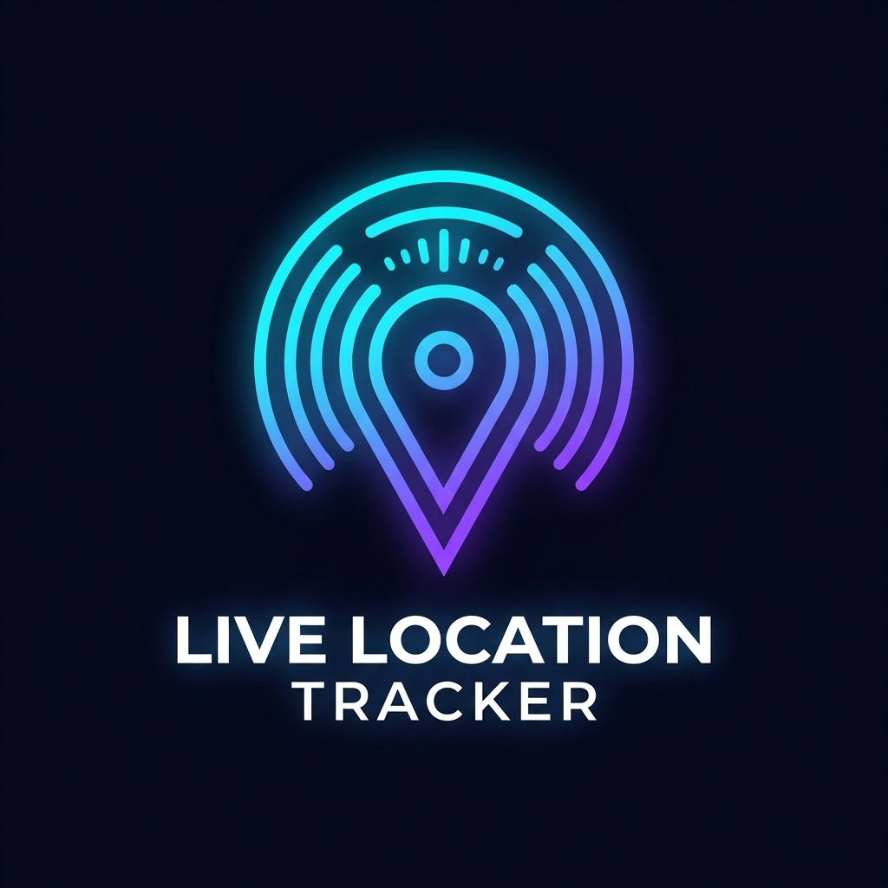
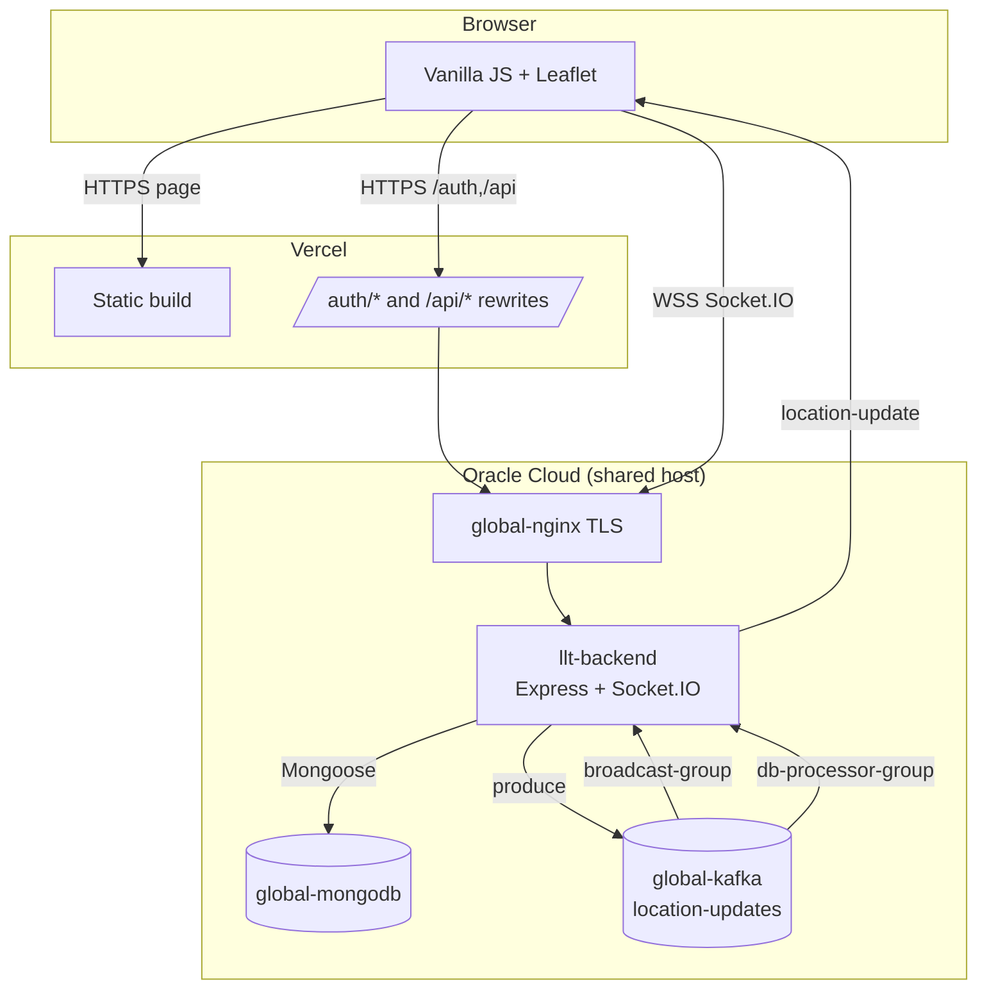

<p align="center">
  
</p>

<h1 align="center">Live Location Tracker</h1>

<p align="center">
  <b>Real-time location sharing for small groups — live map, friends, guest links, and geofence alerts.</b>
</p>

<p align="center">
  <a href="https://live-location-tracker-jade.vercel.app/" target="_blank">
    
  </a>
  
  
  
  
  
  
</p>

---

## 🚀 Overview

Live Location Tracker is a browser-based, real-time location-sharing app.
Signed-in users put their live GPS position on a Leaflet map, see accepted
friends, issue time-limited share links for guests, and create enter/exit
geofence alerts. It is built for small groups coordinating a trip or meetup;
the same codebase is also a working reference for Socket.IO + Kafka + batched
MongoDB writes.

The backend is intentionally a **single Node process**. That keeps Socket.IO
state and per-user rate limits simple; it also means the app does not claim
horizontal scale. See [docs/PERFORMANCE.md](docs/PERFORMANCE.md) for the
measured baseline and the scaling triggers.

### Why Kafka?

The location write path is decoupled from fan-out and persistence:

1. **Real-time path** — a broadcast consumer reads the event and pushes it to
   the owner, accepted friends, and active share rooms over Socket.IO.
2. **Persistence path** — a separate consumer buffers events and writes them
   to MongoDB in batches of up to 50 (or every 5 seconds).

Kafka is on the location path only. Auth, friends, geofences, and share-link
creation are synchronous HTTP + MongoDB operations.

---

## ✨ Features

- **🔐 Google sign-in** — OAuth 2.0 via Passport, plus a 24-hour JWT for the
  cross-domain Vercel + backend setup.
- **🛰️ Live GPS tracking** — browser Geolocation API with high-accuracy
  `watchPosition`; the client sends at most once every 5 seconds and the
  server enforces a 3-second per-user limit.
- **🗺️ Five basemaps** — keyless Esri World Dark/Light Gray Canvas for the dark
  UI, OpenStreetMap Standard, Esri Satellite, and OpenTopoMap Terrain. The
  choice is remembered locally.
- **🛣️ OSRM routing** — driving, walking, and cycling profiles, route steps,
  and auto-reroute after moving more than 15 m. The public OSRM servers have no
  SLA; see the integration notes.
- **🌡️ Live weather** — current conditions from Open-Meteo, cached for 5
  minutes beside the username. Failure is silent and graceful.
- **⛽🏥 Explore nearby POIs** — Petrol, Hospital, and Food filters query
  Nominatim within the current map bounds and overlay the results.
- **🔍 Search with viewbox bias** — instant place suggestions, restricted to
  India (`countrycodes=in`) with a Leaflet bounding-box bias.
- **💡 Geocode fallback** — drops leading building components and strips common
  road suffixes before retrying Nominatim.
- **🔄 Auto-rerouting** — recalculates a route from “Your location” when the
  user moves more than 15 m.
- **👥 Multi-session support** — a user can be connected from several tabs or
  devices without one tab disconnecting the others.
- **🔗 Share links and QR codes** — `1h`, `8h`, or `forever` links open at
  `/track/:code`; guests need no account and receive live updates.
- **🤝 Friends** — request by email, accept/remove, and only accepted friends
  receive each other's positions.
- **📍 Geofence alerts** — enter, exit, or both, for accepted friends; a
  connected owner gets an in-app toast, and a browser notification fires if
  permission was granted.
- **⚡ Kafka + batched MongoDB writes** — the broadcast and persistence
  consumers run independently; `eventId` makes retries idempotent.
- **📱 Responsive** — floating glass panels on desktop, bottom sheets and a
  four-button nav on mobile.
- **📲 Installable PWA** — manifest and service worker cache the app shell and
  map tiles. The worker also caches same-origin API GETs; see
  [docs/SECURITY.md](docs/SECURITY.md) before relying on logout on a shared
  device.

---

## 🛠️ Tech Stack

- **Frontend**: HTML5, hand-written CSS (glassmorphism), vanilla JavaScript ES
  modules, Vite 5 for the static build
- **Maps, routing & APIs**: Leaflet 1.9.4, Esri ArcGIS tiles, OpenStreetMap,
  OpenTopoMap, OSRM, Nominatim, Open-Meteo
- **Backend**: Node.js 22, Express 4, Socket.IO 4
- **Messaging**: Apache Kafka 3.9 (KRaft) via KafkaJS
- **Database**: MongoDB 7 via Mongoose 8
- **Auth**: Passport.js (Google OAuth 2.0) + JWT (`jsonwebtoken`)
- **Deployment**: Oracle Cloud (backend Docker container behind shared nginx)
  + Vercel (static frontend), with shared MongoDB and Kafka

Exact installed versions and the deployment topology are in
[docs/ARCHITECTURE.md](docs/ARCHITECTURE.md) and
[docs/DEPLOYMENT.md](docs/DEPLOYMENT.md).

---

## 📐 Architecture



HTTP is same-origin through Vercel rewrites. Socket.IO connects directly to
the backend because Vercel cannot carry the WebSocket upgrade.

---

## 🏁 Getting Started

### Prerequisites

- **Node.js 22+** (the production image is `node:22-alpine`)
- **Docker & Docker Compose** for local Kafka and MongoDB
- A **Google Cloud project** with OAuth 2.0 credentials

### 1. Start local infrastructure

```bash
docker compose up -d
```

This starts Kafka on `localhost:9092` and MongoDB on `localhost:27018`.
Both are project-local containers, separate from production.

### 2. Install backend dependencies

```bash
cd backend
npm install
```

### 3. Configure `backend/.env`

```env
GOOGLE_CLIENT_ID=your_id
GOOGLE_CLIENT_SECRET=your_secret
SESSION_SECRET=your_random_secret
MONGODB_URI=mongodb://localhost:27018/location-tracker
KAFKA_BROKER=localhost:9092
PORT=3000
CLIENT_URL=http://localhost:3000

# Optional locally; defaults to /auth/google/callback on the backend origin.
# GOOGLE_CALLBACK_URL=http://localhost:3000/auth/google/callback
```

For local Google sign-in, register this exact authorized redirect URI:

```text
http://localhost:3000/auth/google/callback
```

Never commit the `.env` file. See
[docs/ENVIRONMENT.md](docs/ENVIRONMENT.md) for every variable and what breaks
without it.

### 4. Run the app

```bash
npm run dev
```

Open <http://localhost:3000>. The backend serves the static frontend in local
development.

### Optional: Vite dev server

```bash
cd frontend
npm install
npm run dev
```

Set `CLIENT_URL=http://localhost:5173` in `backend/.env` so CORS and Socket.IO
allow the Vite origin. The backend must still be running on `:3000`.

### Production

The backend runs as `llt-backend` on Oracle Cloud; the frontend is deployed by
Vercel. Pushes to `main` that touch `backend/**`, `scripts/**`,
`docker-compose.prod.yml`, or the deploy workflow trigger the backend deploy.
The constraints, health checks, rollback, and required GitHub secrets are in
[docs/DEPLOYMENT.md](docs/DEPLOYMENT.md).

---

## 📚 Documentation

The full documentation system lives in [`docs/`](docs/README.md):

| Start with | Why |
|---|---|
| [docs/README.md](docs/README.md) | Index, reading order, and known doc/code conflicts |
| [docs/ARCHITECTURE.md](docs/ARCHITECTURE.md) | Runtime model, data flow, and key decisions |
| [docs/API.md](docs/API.md) | Every endpoint and socket event |
| [docs/DATABASE.md](docs/DATABASE.md) | Models, indexes, TTL, and schema hazards |
| [docs/SECURITY.md](docs/SECURITY.md) | Controls and verified gaps |
| [docs/TESTING.md](docs/TESTING.md) | What can actually be verified (there is no test suite) |
| [AGENTS.md](AGENTS.md) | Mandatory rules for AI coding agents |

---

## 🛠️ Troubleshooting

| Issue | Potential solution |
| --- | --- |
| **“Connection failed” / sent back to login** | The JWT or session expired. Sign in with Google again. |
| **“Reconnecting…”** | The backend or Socket.IO is unreachable. Check the backend container and `VITE_API_BASE`/`VITE_SOCKET_URL`. In production, Socket.IO must connect directly to the backend origin, not Vercel. |
| **Map is blank** | Check the tile provider and the Leaflet CDN in the browser Network tab. Try switching basemaps. |
| **Location not moving** | Click **Share Location** and grant browser permission. The client sends at most once every 5 seconds. |
| **Kafka errors** | Ensure `docker compose up -d` is running locally, or `global-kafka` is healthy on the server. Kafka failure does not stop HTTP, but live updates and history stop. |
| **Google `redirect_uri_mismatch`** | Register the exact callback URI (`http://localhost:3000/auth/google/callback` locally, `https://live-location-tracker-jade.vercel.app/auth/google/callback` in production) and check `GOOGLE_CALLBACK_URL`. |
| **Share link shows “inactive or expired”** | The link was stopped or its `expiresAt` passed. An active link whose owner has no point left after the 24-hour history TTL loads without a marker, not as inactive. |
| **Local `npm run build` fails on `@rollup/rollup-*`** | The local optional dependency is incomplete; reinstall `frontend/node_modules` consistently. Vercel builds the same source successfully. |

Symptom-by-symptom diagnostics:
[docs/TROUBLESHOOTING.md](docs/TROUBLESHOOTING.md).

---

## 📜 License

MIT, as declared in `backend/package.json`. **No `LICENSE` file is currently
tracked in this repository**; add one before redistributing if a standalone
license text is required.

---

<p align="center">
  Built with ❤️ for the Developer Cohort
</p>
