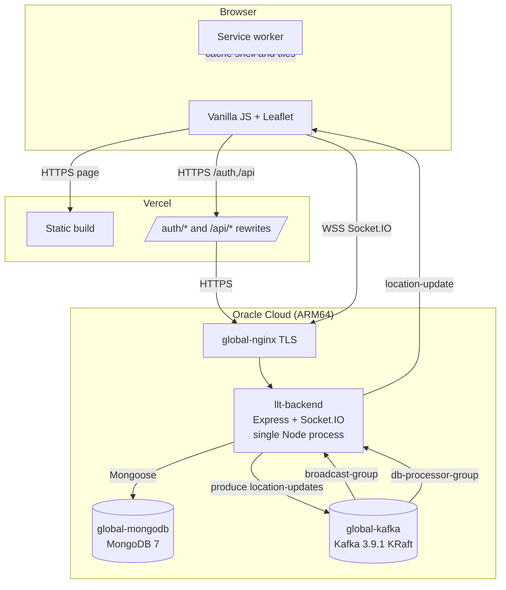
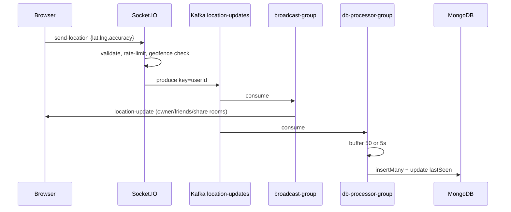

# Live Location Tracker — Architecture

> Where the code lives and why it is shaped that way.
> Filled from the implementation on 2026-10-20.

---

## 1. System Overview

The product has two deployable surfaces:

- a **static frontend** on Vercel (`frontend/`), built by Vite and served from
  `live-location-tracker-jade.vercel.app`
- a **single Node.js backend** on Oracle Cloud (`llt-backend`) that serves the
  HTTP API, the OAuth callback, and the Socket.IO endpoint

Vercel rewrites `/auth/*` and `/api/*` to the backend origin, so browser HTTP
requests stay on the Vercel origin. Socket.IO **cannot** be proxied by a Vercel
rewrite, so the browser opens a WebSocket directly to the backend origin. TLS
for the backend is terminated by the shared `global-nginx` container.

The backend writes every location event to Kafka. Two independent consumer
groups read the same topic: one broadcasts to connected sockets, the other
batches writes into MongoDB. Both MongoDB and Kafka are shared, server-level
Docker containers on `platform-network`.



The frontend is **not** part of the backend image. `frontend/` is excluded by
`backend/.dockerignore`, and the backend only serves static files when it is
run from a checkout that contains `frontend/index.html`.

---

## 2. Repository Layout

```text
Live Location Tracker/
├── AGENTS.md                     Root rules for AI coding agents
├── README.md                     Public project README
├── DEPLOYMENT.md                 Original root deployment runbook
├── .env.production.example       Production variable template (placeholders only)
├── docker-compose.yml            Local Kafka + MongoDB
├── docker-compose.prod.yml       Backend-only production compose (`name: llt`)
├── backend/
│   ├── Dockerfile                node:22-alpine, non-root, backend-only
│   ├── package.json              CommonJS, start/dev scripts
│   ├── .env.example              Local backend variable template
│   └── src/
│       ├── server.js             Express + session + Socket.IO + bootstrap
│       ├── metrics.js            Prometheus registry + `/metrics` handler
│       ├── config/
│       │   ├── db.js             Mongoose connection
│       │   ├── kafka.js          Kafka client, producer, consumers, topic
│       │   └── passport.js       Google OAuth strategy and session serialization
│       ├── middleware/
│       │   └── auth.js           `getRequestUser` and `requireAuth`
│       ├── models/               User, Friend, Geofence, ShareSession, LocationHistory
│       ├── routes/               auth, share, friends, geofences
│       ├── consumers/
│       │   ├── broadcastConsumer.js  Kafka → Socket.IO fan-out
│       │   └── dbConsumer.js         Kafka → batched MongoDB writes
│       └── socket/
│           └── handler.js        Auth, active users, location events, geofences
├── frontend/
│   ├── index.html                Single page, login + map + all panels
│   ├── css/style.css             All styles and design tokens
│   ├── js/
│   │   ├── app.js                Entry point and orchestration
│   │   ├── auth.js               REST auth, token storage, login/logout
│   │   ├── socket.js             Socket.IO client and share viewer
│   │   ├── map.js                Leaflet setup, tile layers, markers
│   │   ├── search.js             Nominatim search, reverse geocode, POIs
│   │   ├── directions.js         OSRM routing, geocode fallback, auto-reroute
│   │   ├── tools.js              Measure, pin, coordinates, fullscreen
│   │   ├── sharing.js            Share links/QR, friends, guest viewer
│   │   └── geofencing.js         Geofence create/list/delete
│   ├── public/                   manifest.json, sw.js
│   └── vercel.json               Rewrites and no-store headers
├── deploy/
│   └── nginx/llt.conf            Tracked copy of the shared-nginx vhost
├── scripts/
│   ├── deploy.sh                 Build/recreate backend, poll health
│   ├── install-nginx-vhost.sh    Check or apply the tracked nginx vhost
│   └── server-setup.sh           One-time server bootstrap
├── .github/workflows/deploy.yml  Push-triggered rsync + SSH deploy
└── docs/                         This documentation system
```

Generated and ignored: `backend/node_modules/`, `frontend/node_modules/`,
`frontend/dist/`, `.env` files, `backend/scratch/` (local scratch).

---

## 3. Runtime Model

| Aspect | Value |
|---|---|
| Process model | **One** Node.js process per backend container (`node src/server.js`); no PM2 cluster, no horizontal replicas |
| Container | `llt-backend`, image `llt-backend:latest`, `restart: unless-stopped`, memory limit `1G`, no published host port |
| Network | `platform-network` (external Docker network), shared with nginx, MongoDB, and Kafka |
| Scaling limit | WebSocket fan-out and Kafka ordering both assume a single process and a single partition |
| Why that limit exists | `activeUsers` and `rateLimitMap` are in-memory `Map`s; the broadcast consumer has an in-memory dedup cache; there is no Socket.IO Redis adapter and no sticky-session layer. A second replica would not see the first replica's sockets, so events would be silently missing. |

The Dockerfile states this explicitly. **Do not add replicas** without first
adding a Socket.IO adapter and sticky sessions, and reviewing the in-memory
state. Do not increase Kafka partitions without reviewing the `userId` key
ordering and the single-partition consumer assumption.

---

## 4. Request Lifecycle

### 4.1 An authenticated HTTP request

1. The browser calls a same-origin path such as `/api/friends` on the Vercel
   domain (`frontend/js/auth.js` returns `''` for the API base in production).
2. Vercel matches the `/api/:path*` rewrite and proxies to
   `https://llt.140-245-27-200.sslip.io/api/:path*`.
3. `global-nginx` terminates TLS and proxies to `llt-backend:5000` over
   `platform-network`. The app-specific vhost is tracked at
   `deploy/nginx/llt.conf` and installed into the shared nginx config dir only
   by an explicit, confirm-gated script.
4. Express runs `express.json()`, `express-session` (Mongo-backed), Passport
   initialization, then the router.
5. `requireAuth` first checks the Passport session (`req.user`), then a
   `Bearer` JWT from `Authorization`. It loads the user from MongoDB and sets
   `req.authUser`.
6. The route scopes its query to `req.authUser._id`, returns JSON, or calls
   `next(error)`.
7. There is **no custom error-handling middleware**, so an unexpected error
   reaches Express's default handler. The response is generic in production
   but can include a stack trace when `NODE_ENV` is not `production`.

### 4.2 A location event

1. `navigator.geolocation.watchPosition` updates the local map immediately and
   throttles sends to once every **5 seconds** (`app.js`).
2. `SocketManager.sendLocation` emits `send-location` with the JWT in the
   handshake auth payload.
3. The Socket.IO middleware accepts the JWT, or falls back to the session; a
   share guest is accepted only with a valid `shareCode`.
4. `socket/handler.js` validates numeric ranges, applies a **3-second per-user**
   rate limit, updates `activeUsers`, evaluates active geofences with a
   haversine distance, and emits `geofence-alert` to the fence owner when a
   boundary is crossed.
5. The handler produces one event to Kafka topic `location-updates`, keyed by
   `userId` (single partition).
6. `broadcastConsumer` (group `broadcast-group`) deduplicates by `eventId`,
   then emits `location-update` to the owner, every accepted friend, and every
   active share room owned by that user.
7. `dbConsumer` (group `db-processor-group`) buffers events and calls
   `insertMany` when the buffer reaches **50** or every **5 seconds**. It also
   updates `User.lastSeen`.

### 4.3 A share-link view

1. A guest opens `/track/:code`. Vercel serves `index.html` via the SPA
   fallback.
2. `GET /api/share/:code` (public) returns the session and the owner's latest
   `LocationHistory` point.
3. The guest connects with `auth: { shareCode }`; the socket joins
   `share:<code>`.
4. `broadcastConsumer` emits `share-location-update` to that room for each new
   event owned by the link owner.
5. Stopping the link sets `isActive: false` and emits `share-session-ended` to
   the room.

---

## 5. Data Flow



The HTTP API is synchronous with MongoDB. Kafka is on the **location write**
path only; share-link creation, friends, and geofences do not use Kafka.

---

## 6. External Dependencies

| Service | Purpose | Failure mode |
|---|---|---|
| Google OAuth 2.0 | Sign-in and profile | Login fails or redirects with `?error=auth_failed`; existing JWTs/sessions may still work |
| MongoDB (`global-mongodb`) | Users, friends, geofences, shares, history | Backend exits at startup if it cannot connect; `/health` returns `503` after a later disconnect; most routes fail |
| Kafka (`global-kafka`) | Location event bus | The HTTP server still starts; `send-location` fails until Kafka reconnects; no broadcasts or history writes |
| `global-nginx` | TLS and reverse proxy to the backend | Browser cannot reach the API or socket |
| Vercel | Static hosting, `/auth` + `/api` rewrites | Frontend unavailable; API is still directly reachable |
| Esri ArcGIS tiles | Dark, light, satellite basemaps | Blank/failed tiles; map controls still work |
| OpenStreetMap tiles | Standard basemap | Blank/failed tiles |
| OpenTopoMap | Terrain basemap | Blank/failed tiles |
| Nominatim | Search and reverse geocoding | No suggestions or address; search UI shows an error/empty state |
| OSRM (`router.project-osrm.org`) | Driving/walking/cycling routes | Route fails; a toast/error is shown, map remains usable |
| Open-Meteo | Weather widget | Weather stays hidden; failure is logged to the console |
| `ui-avatars.com` | Fallback avatars | Broken/placeholder avatar if unreachable |
| Google Fonts, unpkg, cdnjs, cdn.socket.io | Fonts, Leaflet, Socket.IO client, QRCode | Unstyled map or missing QR/socket client; no local fallback |

See [INTEGRATIONS.md](./INTEGRATIONS.md) for details.

---

## 7. Key Decisions

| # | Decision | Why | Alternative rejected |
|---|---|---|---|
| 1 | Kafka between socket ingest and fan-out/persistence | Decouples real-time delivery from batched writes; one event feeds both consumers | Writing to MongoDB on every socket event (higher write load) and broadcasting inline (no buffer/replay) |
| 2 | Single partition, keyed by `userId` | Preserves per-user ordering and works on minimal Kafka setups | Multiple partitions (would require ordering/consumer review) |
| 3 | Single Node process | Socket.IO and rate-limit state are in memory | PM2 cluster/replicas without a Socket.IO adapter and sticky sessions |
| 4 | JWT in `localStorage` **plus** a server session | Works across the Vercel → backend domain boundary and in incognito; session remains for same-origin/local | Cookie-only auth (cross-site cookie restrictions) or JWT-only (no server session) |
| 5 | Vercel rewrites for `/auth` and `/api` | Keeps HTTP on the Vercel origin and hides the backend host in the address bar | Browser calls to the raw backend origin (CORS + visible host) |
| 6 | Socket.IO connects directly to the backend | Vercel rewrites cannot carry WebSocket upgrades | Proxying WebSockets through Vercel (not supported by this setup) |
| 7 | Shared server-level MongoDB and Kafka | Reuse existing infrastructure; no per-project database containers | Per-project containers (duplicated data/services) |
| 8 | 24-hour TTL on `LocationHistory` | Bounds storage and retention for a live-tracking product | Unbounded history (privacy/storage cost) |
| 9 | No migration framework | The schema is small and MongoDB is schemaless | Inventing a migration system for a few models |

---

## 8. Known Technical Debt

| # | Item | Impact | Fix cost |
|---|---|---|---|
| 1 | No automated tests, lint, or type check | Regressions rely on manual smoke tests | Medium: add a runner and CI job |
| 2 | CI deploys on push with no test gate | A broken backend can deploy | Low: add a test/health job with `needs:` once tests exist |
| 3 | In-memory `activeUsers`, `rateLimitMap`, and broadcast dedup cache | State is lost on restart and cannot be shared across replicas | Medium: Redis adapter + shared limiter |
| 4 | `allowedViewers` is stored but never enforced | A creator may believe a link is restricted when it is not | Low–medium: enforce or remove |
| 5 | JWT in URL query and `localStorage` | Token can leak via history/referrer/XSS | Medium: move to an httpOnly cookie or one-time code exchange |
| 6 | No JWT revocation | Logout cannot invalidate a stolen token | Medium: token version/denylist |
| 7 | No HTTP rate limiting | Public share lookup and auth routes can be hammered | Low: add an IP/user limiter |
| 8 | No centralized error handler; `X-Powered-By` enabled | Inconsistent errors; framework fingerprinting | Low |
| 9 | Two copies of `escapeHtml` and `formatExpiry`-style formatting in frontend modules | Drift risk | Low: extract a shared utility |
| 10 | Public README and docs can drift from code | Misleads contributors and agents | Low: keep [README.md](./README.md) §6 current and update docs in the same change |
| 11 | Public demo OSRM/Nominatim with no SLA or fallback | Routing/search can fail without warning | Medium: provider with an SLA or documented fallback |
| 12 | Service worker caches same-origin API GETs cache-first; cache key ignores `Authorization` and is not cleared on logout | Stale or prior-user data can be shown on a shared device | Low–medium: exclude `/api/*` and `/auth/*`, or version/clear the cache on logout |
