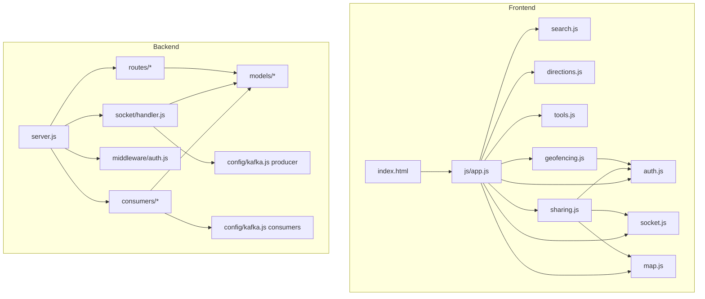

# Live Location Tracker — Code Style

> How to write code that fits this codebase without a reviewer asking.
> Filled from the implementation on 2026-10-20.

---

## 1. General Principles

Match the existing code. No drive-by refactors.

This is a small, explicit codebase:

- **Backend:** CommonJS, Express, Mongoose, KafkaJS, Socket.IO.
- **Frontend:** browser ES modules, vanilla DOM, Leaflet, Socket.IO client.
- **No TypeScript, no React, no bundler beyond Vite for the static build.**
- **No service layer, no dependency-injection container, no validation
  library.** A route may query a model directly.
- **One Node process** on purpose. Do not introduce clustering or replicas
  without solving the in-memory Socket.IO state.

---

## 2. Language and Module System

| Aspect | Convention |
|---|---|
| Language | JavaScript (ES2022+). No TypeScript, no JSX. |
| Backend modules | **CommonJS**: `require(...)` / `module.exports`. Files end in `.js`. |
| Frontend modules | **ES modules** (`<script type="module">`): `import` / `export`. `frontend/package.json` has `"type": "module"`. |
| Strictness | No `tsconfig`, no ESLint config, no Prettier config, and no explicit `"use strict"` pragmas (CommonJS is not strict by default). Match the surrounding file. |
| Runtime | Production `node:22-alpine`; local docs session Node 24.21.0. Do not use APIs that require a newer Node without checking the Dockerfile. |
| Browser support | Modern evergreen browsers; ES modules and `navigator.geolocation` are required. No transpilation/polyfill layer in the app code. |

Do not convert a CommonJS file to ESM (or vice versa) as part of an unrelated
change.

---

## 3. Naming

| Thing | Convention | Example |
|---|---|---|
| Backend files | Lowercase / camelCase, descriptive | `broadcastConsumer.js`, `dbConsumer.js`, `auth.js` |
| Model files | PascalCase, singular | `User.js`, `ShareSession.js`, `LocationHistory.js` |
| Frontend files | Lowercase, feature name | `app.js`, `socket.js`, `directions.js` |
| Functions / variables | camelCase | `validateLocationData`, `flushBuffer`, `activeUsers` |
| Constants | UPPER_SNAKE_CASE | `TOPIC`, `RATE_LIMIT_MS`, `BATCH_SIZE`, `SEND_INTERVAL` |
| Mongoose models | PascalCase singular, exported as the model | `mongoose.model('LocationHistory', ...)` |
| Mongoose fields | camelCase | `userId`, `targetUserId`, `shareCode`, `expiresAt` |
| Frontend managers | PascalCase IIFE export | `AuthManager`, `MapManager`, `DirectionsManager` |
| DOM ids | kebab-case | `btn-share-location`, `community-panel`, `share-link-output` |
| CSS classes | kebab-case | `glass-panel`, `btn-danger-quiet`, `mobile-bottom-nav` |
| Data attributes | kebab-case | `data-community-tab`, `data-stop-share`, `data-mobile-action` |
| Environment variables | UPPER_SNAKE_CASE | `MONGODB_URI`, `GOOGLE_CALLBACK_URL`, `VITE_API_BASE` |
| Socket events | kebab-case | `send-location`, `location-update`, `share-session-ended` |
| API paths | Lowercase, kebab where multiword | `/api/share/my-sessions`, `/api/geofences` |

Boolean fields read as predicates: `isActive`, `isAvailable()`, `isOpen()`.

---

## 4. Layering

Rules:

| Rule | Detail |
|---|---|
| `server.js` is bootstrap only | Environment validation, Express/session/Socket.IO setup, route mounting, health, static frontend, Kafka startup, graceful shutdown. Do not put feature logic here. |
| Routes own HTTP | Parsing/validating input, auth, response shape, and status codes live in `routes/*`. They call models directly. |
| Models own schema | Field constraints, indexes, methods (`ShareSession.isAvailable`). Do not put route-specific logic in a model. |
| Socket handler owns realtime input | Validation, rate limiting, active-user state, geofence evaluation, and the single Kafka produce call. |
| Consumers own Kafka reads | `broadcastConsumer` fans out; `dbConsumer` batches persistence. Do not add a second producer or a third consumer group without an architecture review. |
| Frontend `app.js` orchestrates | It wires managers, auth, socket callbacks, geolocation, toasts, and the mobile nav. Feature DOM logic belongs in the manager. |
| Managers do not own global state | They read their own DOM and call `AuthManager` for the API base/headers. `MapManager` owns markers; `SocketManager` owns the socket. |
| No service/controller/repository abstraction | Adding one would be a new architecture. Match the existing route → model pattern. |

A new HTTP endpoint goes in an existing router (or a new router mounted in
`server.js`), uses `requireAuth` unless deliberately public, and calls a model.

---

## 5. Error Handling

| Case | Convention |
|---|---|
| Expected HTTP failure | Return the status directly: `res.status(400).json({ success: false, message: '...' })` |
| Unexpected HTTP failure | `try/catch` around the handler body, then `next(error)` |
| Missing auth | `requireAuth` returns `401 { success:false, message:'Authentication required' }` |
| Socket input failure | `socket.emit('error-message', { message: '...' })`; do not throw into the socket |
| Kafka message failure | `try/catch` per message; log `error.message`; continue the consumer |
| DB batch failure | Duplicate key (`11000`) is expected and logged; other errors requeue the batch |
| Frontend request failure | Parse JSON if possible, then `showToast(message, 'error')`; do not leave a rejected promise unhandled |
| Third-party map/weather failure | Weather logs `console.warn` and hides; search/directions show an escaped error state |
| Startup failure | `validateEnv()` exits with a clear message; Mongo connection failure exits; Kafka failure is logged and the HTTP/socket server stays up in a degraded mode |

There is **no custom Express error middleware**. Do not assume every error is
JSON; an unhandled route can return Express's default HTML response. Do not
leak `error.stack` to a client.

`console.error` is acceptable for server diagnostics; never log a JWT, cookie,
password, API key, or full connection URI.

---

## 6. Validation

There is **no validation library**. Use explicit checks and Mongoose schema
validation:

- Read named fields, never spread `req.body`.
- Allow-list accepted keys (see geofence PATCH).
- Check types and ranges before a database write.
- Let Mongoose enforce enums, min/max, and required fields, and use
  `runValidators: true` on updates.
- Escape or avoid user data in `innerHTML`. `sharing.js` and `geofencing.js`
  have a local `escapeHtml`; `app.js` and `map.js` currently do not (a known
  XSS gap — see [SECURITY.md](./SECURITY.md) §9). New code must escape.
- Do not trust the frontend's rate limit; the server enforces its own socket
  limit.

Status codes: `400` invalid input, `401` no auth, `403` authenticated but not
allowed, `404` missing/resource not owned, `201` created, `200` success,
`503` health degraded.

---

## 7. Async

- Use `async/await` rather than raw `.then()` chains.
- Use `Promise.all` for independent queries (the friends list does this).
- Await writes that must finish before the response; do not fire-and-forget a
  database write in a route.
- Kafka startup is intentionally backgrounded: the HTTP server listens first,
  then `initKafka()` connects the producer and starts consumers. If Kafka
  fails, the socket handler is still initialised for basic connectivity.
- The DB consumer's `flushBuffer` is a shared buffer with a 5-second interval;
  it is not locked. Do not call it concurrently from a new path.
- Do not add an unawaited promise that can reject without a `catch`; Node will
  eventually terminate on an unhandled rejection.
- Graceful shutdown awaits consumer stops, Kafka disconnect, Mongo close, and
  `server.close`.

---

## 8. Comments

- Keep the existing file-header comment block. It explains the module's role.
- Comment **why**, especially for non-obvious constraints:
  - why Socket.IO connects directly instead of through Vercel
  - why the server is a single process
  - why Kafka is on the location path
  - why a socket is not disconnected after a period without location
  - why `/health` checks the database
- Do not narrate obvious code (`// increment i`).
- Do not leave commented-out code or stale TODOs. If something is intentionally
  deferred, write a precise comment with the reason.
- Do not put secrets or personal data in comments.

---

## 9. Anti-Patterns

| # | Do not | Because |
|---|---|---|
| 1 | Add React, Vue, a state library, or a component framework | The UI is vanilla DOM + managers; a framework would be a rewrite |
| 2 | Add TypeScript or a build-time type checker to the backend | No build step exists; Node runs the source directly |
| 3 | Add `zod`/`joi`/`yup` for one route | Existing validation is hand-rolled + Mongoose; adding a library is a dependency decision |
| 4 | Add a service/repository layer | Routes already call models; a new layer would diverge from the codebase |
| 5 | Spread `req.body` into `create`/`update` | Mass assignment; use named fields/allow-lists |
| 6 | Change an API response shape or socket event name | The frontend and share viewer depend on the current shapes |
| 7 | Change a status code or error message that the client displays | UI messages and tests/manual checks may depend on it |
| 8 | Add a second Kafka producer/consumer group | Ordering, consumer-group, and single-process assumptions need review |
| 9 | Add PM2 cluster mode or replicas | In-memory `activeUsers`, rate limits, dedup cache, and Socket.IO fan-out are single-process |
| 10 | Add a second copy of `escapeHtml`/`formatExpiry` | There are already duplicates in `sharing.js` and `geofencing.js`; extract instead of adding a third |
| 11 | Use unescaped `innerHTML` with user/third-party data | Stored XSS; the JWT is in `localStorage` |
| 12 | Put a secret in `VITE_*` or `frontend/.env` | Vite ships it to every browser |
| 13 | Change `trust proxy`, CORS, cookie settings, or middleware order | Security controls; require review |
| 14 | Upgrade a dependency as part of an unrelated fix | Versions are pinned by the lockfile; upgrades need testing and authorisation |
| 15 | Add a test runner/framework without authorisation | `package.json` has no test script today |
| 16 | Commit `.env`, `dist/`, `node_modules/`, or a private key | Secret/build hygiene; deploy and Docker ignore these |
| 17 | Change public README/doc claims without checking the code | Docs must stay in sync; update code and docs together (see [README.md](./README.md) §6) |

---

## 10. Checklist

- [ ] Reused an existing helper rather than writing a new one
- [ ] Followed the layering in §4
- [ ] Used the project's `{ success, ... }` response shape and status codes
- [ ] Validated input with an allow-list; did not spread `req.body`
- [ ] Escaped user data in any HTML string
- [ ] Did not change an existing event, response shape, or enum by accident
- [ ] Ran the applicable command and saw the output (there are **no automated
      tests**; say what you actually ran)
- [ ] Updated the matching document in the same change
- [ ] Checked `git diff` for unintended changes
