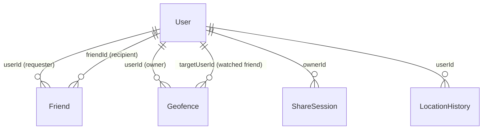

# Live Location Tracker — Database

> Models, fields, indexes, and the hazards in this schema.
> Filled from the Mongoose models on 2026-10-20.

---

## 1. Engine

| Aspect | Value |
|---|---|
| Database | MongoDB 7 (`mongo:7`), shared container `global-mongodb` in production and `mongo-location-tracker` locally. **VERIFIED** |
| ODM | Mongoose 8.23.1 installed (declared `^8.6.0`). **VERIFIED** |
| Connection string env var | `MONGODB_URI` (required; `backend/src/server.js` exits if absent). **VERIFIED** |
| Pool settings | None set in `backend/src/config/db.js`; Mongoose defaults apply. Pool size and timeouts have **not** been measured in production. **UNKNOWN** |
| Session store | `connect-mongo` 5.1.0 writes sessions to the same MongoDB, TTL 1 day. **VERIFIED** |
| Transactions | **None.** No `session.startTransaction()` anywhere. Multi-document writes are not atomic. **VERIFIED** |
| Migration framework | **None.** See §8. **VERIFIED** |

The database name is `location_tracker` in production and `location-tracker`
in the local example URI (`backend/.env.example`). The actual values live only
in the server `.env` and are not reproduced here.

---

## 2. Models

| Model | Purpose | Key fields | Indexes |
|---|---|---|---|
| `User` | Google identity and profile | `googleId` (required, unique), `displayName`, `email`, `avatar`, `lastSeen`; `createdAt`/`updatedAt` | `{ googleId: 1 }` unique |
| `Friend` | Directional relationship between two users | `userId`, `friendId`, `status` (`pending`/`accepted`/`blocked`); timestamps | `{ userId: 1 }`, `{ friendId: 1 }`, `{ status: 1 }`, `{ userId: 1, friendId: 1 }` unique, `{ userId: 1, status: 1 }`, `{ friendId: 1, status: 1 }` |
| `Geofence` | An owner's alert around a target friend | `userId` (owner), `targetUserId`, `center.lat/lng`, `radius` 25–100000 m, `name` ≤80 chars, `triggerOn` (`enter`/`exit`/`both`), `isActive`, `lastState` (`inside`/`outside`/`unknown`); timestamps | `{ userId: 1 }`, `{ targetUserId: 1 }`, `{ targetUserId: 1, isActive: 1 }` |
| `ShareSession` | A time-limited public share link | `shareCode` (unique), `ownerId`, `expiresAt` (nullable), `isActive`, `allowedViewers[]`; timestamps | `{ shareCode: 1 }` unique, `{ ownerId: 1 }`, `{ expiresAt: 1 }`, `{ isActive: 1 }`, `{ ownerId: 1, isActive: 1, expiresAt: 1 }` |
| `LocationHistory` | The latest point and short history for a user | `userId`, `displayName`, `latitude`, `longitude`, `accuracy`, `eventId` (unique), `timestamp`, `processedAt` | `{ userId: 1, timestamp: -1 }`, `{ timestamp: 1 }` TTL 86400 s, `{ eventId: 1 }` unique |

`LocationHistory` has `timestamps: false`; the others use Mongoose timestamps.

There is **no** separate `Session` model; `connect-mongo` creates its own
collection (default `sessions`) in the same database.

---

## 3. Relationships

There is **no referential integrity at the database level**. MongoDB does not
enforce the `ref` fields, there are no foreign keys, and no delete endpoint
cascades. Deleting a `User` (no such endpoint exists today) would leave orphaned
friends, fences, shares, and history. **VERIFIED**

`Friend` rows are **directional**. Accepting a request creates or updates the
reciprocal row (`friends.js`, `POST /accept/:id`), so the application treats an
accepted pair as two rows. A single row means a pending request in one
direction.

---

## 4. Soft Delete

| Model | Field | Behaviour | Purge path |
|---|---|---|---|
| `ShareSession` | `isActive` | `POST /api/share/:code/stop` sets it to `false`. `GET /api/share/my-sessions` also marks expired sessions inactive. `isAvailable()` requires `isActive` and a future/null `expiresAt`. | **None.** Ended/expired sessions stay forever. |
| `Geofence` | `isActive` | A fence can be deactivated through `PATCH /api/geofences/:id` (the UI uses hard delete). `Geofence.find` in the socket handler only evaluates `isActive: true`. | Hard delete via `DELETE /api/geofences/:id`; inactive rows otherwise stay. |
| `Friend` | — | No soft delete. `DELETE /api/friends/:id` hard-deletes both directions. | Hard delete only. |
| `LocationHistory` | — | No soft delete. | **TTL index** deletes documents 24 hours after `timestamp` (MongoDB's TTL monitor runs about once per minute; deletion is not immediate). |

`ShareSession.expiresAt` is checked in code, but expired sessions are **not**
deleted by a TTL index. `GET /api/share/:code` returns 404 for them, and
`my-sessions` flips `isActive` to false when the owner opens the panel.

---

## 5. Indexes

| Collection | Index | Why it exists |
|---|---|---|
| `users` | `googleId` unique | One account per Google identity; the OAuth strategy looks up by this field |
| `friends` | `userId` | List a user's outgoing/accepted relationships |
| `friends` | `friendId` | List incoming requests and find a target's friends |
| `friends` | `status` | Filter pending/accepted relationships |
| `friends` | `{ userId, friendId }` unique | Prevent duplicate directional requests |
| `friends` | `{ userId, status }` | Accepted friends and outgoing pending requests |
| `friends` | `{ friendId, status }` | Incoming requests and the broadcast consumer's accepted-friend lookup |
| `geofences` | `userId` | List the owner's fences and route alerts to the owner |
| `geofences` | `targetUserId` | Find fences watching a user |
| `geofences` | `{ targetUserId, isActive }` | Per-location-event active-fence lookup |
| `sharesessions` | `shareCode` unique | Public link lookup and socket room key |
| `sharesessions` | `ownerId` | List a user's sessions |
| `sharesessions` | `expiresAt` | Availability checks / expired-session cleanup |
| `sharesessions` | `isActive` | Filter active sessions |
| `sharesessions` | `{ ownerId, isActive, expiresAt }` | Per-location-event active-share lookup and expired-session cleanup |
| `locationhistories` | `{ userId, timestamp: -1 }` | Latest point for a user/share link |
| `locationhistories` | `{ timestamp: 1 }` TTL 86400 | Delete history after 24 hours |
| `locationhistories` | `eventId` unique | Idempotent Kafka consumption; duplicate events are skipped |

The per-event consumer and socket-handler queries now have compound indexes
matching their filters. They were added on 2026-10-20 after the live
`getIndexes()` check showed only the separate single-field indexes. Query-plan
latency under real data is still **UNKNOWN** because `friends`,
`sharesessions`, and `geofences` were empty when the change was made. See
[PERFORMANCE.md](./PERFORMANCE.md) §3.4.

---

## 6. Query Patterns

| Common query | Index used | Risk |
|---|---|---|
| `User.findOne({ googleId })` during OAuth | `googleId` unique | Low |
| `User.findOne({ email: /^...$/i })` during friend request | **No email index** | Collection scan as users grow; the regex is escaped and anchored, but case-insensitive matching still prevents a simple index scan. **INFERRED** |
| `Friend.find({ userId, status: 'accepted' })` | `{ userId, status }` | Low; compound index matches the filter |
| `Friend.find({ friendId, status: 'accepted' })` in the broadcast consumer | `{ friendId, status }` | Low; runs on **every** location event |
| `Friend.findOneAndUpdate({ userId, friendId }, upsert)` | compound unique | Low |
| `Geofence.find({ targetUserId, isActive: true })` | `{ targetUserId, isActive }` | Low; runs on every location event |
| `ShareSession.findOne({ shareCode })` | unique `shareCode` | Low |
| `ShareSession.find({ ownerId, isActive, expiresAt })` | `{ ownerId, isActive, expiresAt }` | Low; runs on every location event for active shares |
| `ShareSession.updateMany({ ownerId, isActive, expiresAt: { $lte } })` | `{ ownerId, isActive, expiresAt }` | Low; expired-session cleanup |
| `LocationHistory.findOne({ userId }).sort({ timestamp: -1 })` | compound `{ userId, timestamp: -1 }` | Low |
| `LocationHistory.insertMany(batch, { ordered: false })` | `eventId` unique | Duplicate-key errors are expected on retry and handled |
| `User.updateMany({ _id: { $in: ids } }, { lastSeen })` | `_id` | One write per batch |

No `explain()` plans, profiler output, or production query timings are recorded.
Treat the “index used” column as the intended index, not a measured plan.

---

## 7. Hazards

1. **Unique indexes over dirty data break model init.** `User.googleId`,
   `Friend.{userId,friendId}`, `ShareSession.shareCode`, and
   `LocationHistory.eventId` are unique. If duplicates already exist, the
   index build fails and Mongoose may log an index error on startup. Dedupe
   before adding or rebuilding a unique index.
2. **No transactions.** Accepting a friend performs two writes; a crash between
   them leaves one side accepted and the other pending. Location history and
   `User.lastSeen` are also written in the same `flushBuffer` try block without
   a transaction. A failure after `insertMany` but before `updateMany` requeues
   the batch; re-inserted duplicates are skipped by `eventId`, but the
   `lastSeen` update can be lost for that batch. **VERIFIED**
3. **TTL is not instant.** MongoDB's TTL monitor runs roughly every 60 seconds;
   a 24-hour-old point can remain briefly. The share endpoint reads the latest
   point, so a link with no fresh updates will show no marker after the TTL
   removes the last point, even while the link is still active. **INFERRED**
4. **Removing a field from a Mongoose schema does not remove it from existing
   documents.** Old fields remain and may be returned by `.lean()` queries or
   populated documents.
5. **Changing a TTL option does not rewrite an existing index.** If
   `expireAfterSeconds` must change, use `collMod` or drop/recreate the index;
   Mongoose's `autoIndex` does not alter an existing index's options. **INFERRED**
6. **`allowedViewers` is not enforced.** It is stored on `ShareSession` but the
   public share endpoint and share socket never check it. Do not treat it as a
   security control. See [SECURITY.md](./SECURITY.md).
7. **`Friend` is directional.** Any query that assumes one row per pair is
   wrong. Both directions are created on accept.
8. **`User.email` is not unique.** Friend search uses `findOne` by email;
   duplicate emails (possible outside Google, or via data edits) resolve to an
   arbitrary first match.
9. **Geofence state is last-write-wins.** `lastState` is read, compared, and
   saved per event without an atomic compare-and-set. Concurrent events for the
   same target can produce a duplicate or missed transition. The app is a
   single process today, but socket handlers run concurrently. **INFERRED**
10. **Per-event query cost is still unmeasured.** Compound indexes now cover
    `Friend.{userId,status}`, `Friend.{friendId,status}`,
    `Geofence.{targetUserId,isActive}`, and
    `ShareSession.{ownerId,isActive,expiresAt}`, but the collections were empty
    when they were added. Real-data query plans and latency remain **UNKNOWN**
    until production has data. **INFERRED**

---

## 8. Schema Change Procedure

**There is no migration framework. Do not invent one for a single change.**

The real procedure is manual:

1. **State the change and its impact** before editing a model: fields, types,
   required flags, enum values, indexes, TTL, and every route/consumer that
   reads the collection.
2. **Check existing data** for conflicts. For a new unique index, run a
   duplicate check first. For a narrowed type or new required field, plan a
   backfill.
3. **Edit the Mongoose model** and update [DATABASE.md](./DATABASE.md),
   [API.md](./API.md), and [SECURITY.md](./SECURITY.md) where relevant.
4. **Test against a copy or a disposable database.** There is no staging
   database defined in this repository.
5. **Deploy.** Mongoose `autoIndex` is enabled by default and will attempt to
   create new indexes when the model initialises. Watch startup logs for index
   errors. For a large collection, build/verify the index explicitly in
   `mongosh`.
6. **Verify** with `db.<collection>.getIndexes()` and a real query.
7. **Backfill** in a separate, resumable script if needed. Do not do an
   unbounded update inside a request handler.

For local work, `docker compose up -d` starts `mongo-location-tracker` on
`localhost:27018` and Kafka on `localhost:9092`. The example URI is
`mongodb://localhost:27018/location-tracker`.

Do **not** run `dropDatabase`, `deleteMany`, `dropIndex`, or volume removal
against production without explicit human authorisation.
