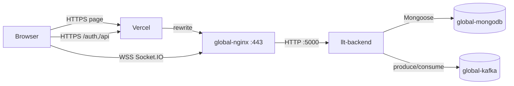

# Live Location Tracker — Deployment

> How this ships, how to verify it, and how to undo it.
> Filled from the compose files, deploy scripts, workflow, and live deployment
> on 2026-10-20.

---

## 1. Environments

| Environment | Frontend | Backend | Branch |
|---|---|---|---|
| Local | Backend serves `frontend/` on `http://localhost:3000`, **or** Vite on `http://localhost:5173` | `node src/server.js` on `:3000`; MongoDB `localhost:27018`, Kafka `localhost:9092` from `docker-compose.yml` | — |
| Preview | Vercel preview deployment (if the Git integration creates one) | **No separate preview backend.** `frontend/vercel.json` hardcodes the production backend origin; `CLIENT_URL`/`GOOGLE_CALLBACK_URL` point at production | Non-`main` branches |
| Production | Vercel: <https://live-location-tracker-jade.vercel.app> | `llt-backend` on Oracle Cloud, behind `global-nginx`, origin <https://llt.140-245-27-200.sslip.io> | `main` |

A Vercel preview is not a full isolated environment: it will call the
production backend and the production OAuth callback. Treat previews as
frontend-only checks.

Local prerequisites:

```bash
# Shared local Mongo + Kafka
docker compose up -d

# Backend (from a checkout; serves the frontend on :3000)
cd backend
npm install          # first time only
npm run dev

# Or frontend in Vite mode (backend must be running on :3000)
cd frontend
npm install          # first time only
npm run dev
```

For Vite mode, set `CLIENT_URL=http://localhost:5173` in `backend/.env` so CORS
and Socket.IO allow the Vite origin. The backend’s session cookie is
`secure: true`; over plain HTTP the session cookie is not set, but the JWT
returned by the OAuth callback still works. See
[TROUBLESHOOTING.md](./TROUBLESHOOTING.md).

---

## 2. Topology



- `llt-backend` is on the external Docker network `platform-network` and
  publishes **no host port**.
- `global-nginx` terminates TLS and is the only public path to the backend.
- This mirrors the existing `vantagehire-backend` and `teambaithak-backend`
  pattern: app container on `platform-network`, no host port, hostname vhost in
  `global-nginx`. The LLT vhost adds `/socket.io/` upgrade headers and long
  read/send timeouts because this app uses WebSockets.
- Vercel cannot carry the WebSocket upgrade; the browser connects directly to
  the backend origin for Socket.IO.
- `app.set('trust proxy', 1)` is a security-relevant setting. Do not change it
  without reviewing the proxy chain.
- The backend image is backend-only. The frontend is not copied into it.

Production paths:

| What | Where |
|---|---|
| App directory | `/opt/apps/live-location-tracker/` |
| Server env | `/opt/apps/live-location-tracker/.env` (mode `600`) |
| Compose file | `/opt/apps/live-location-tracker/docker-compose.prod.yml` |
| Container | `llt-backend` |
| Shared network | `platform-network` |
| Shared Mongo | `global-mongodb` |
| Shared Kafka | `global-kafka` |
| nginx vhost | Infra-managed (`/opt/apps/infra/nginx/conf.d/llt.conf`); reviewable copy at `deploy/nginx/llt.conf` |

---

## 3. Release Procedure

### 3.1 First-time server setup (once)

On the server, from the app directory:

```bash
./scripts/server-setup.sh location_tracker_user '<strong-db-password>'
```

It is idempotent and non-destructive:

1. verifies/creates `platform-network`
2. creates the Mongo user through `/opt/apps/infra/scripts/add-app-mongo-user.sh`
3. creates `.env` from `.env.production.example` **only if missing**, then stops
   so a human can fill in real values

It does **not** start Kafka. Start the shared broker from the Infra repo:

```bash
cd /opt/apps/infra
docker compose up -d kafka
```

Fill in `.env` with real values and set mode `600`. Never copy a local `.env`
to the server, and never print its contents.

### 3.2 Normal release (automated)

```bash
git push origin main
```

The `Deploy Backend to Oracle Cloud` workflow runs when the push touches
`backend/**`, `scripts/**`, `docker-compose.prod.yml`, or the workflow file.
It:

1. checks out the commit
2. writes the SSH key from the `SSH_PRIVATE_KEY` (or `ORACLE_SSH_KEY`) secret
3. runs `ssh-keyscan` against `SERVER_HOST` (or `ORACLE_HOST`)
4. `rsync --delete` the backend to `/opt/apps/live-location-tracker/backend/`,
   excluding `node_modules`, `.env`, `.env.*`, `scratch`, `*.md`, and `README*`
5. rsyncs `docker-compose.prod.yml`, `scripts/`, and `deploy/` **without**
   `--delete`; this makes the tracked nginx vhost available for review but does
   **not** install it
6. SSHes in and runs `./scripts/deploy.sh`

`scripts/deploy.sh` then:

1. checks `.env` and `platform-network`; warns (does not fail) if
   `global-kafka` is missing
2. runs `git pull --ff-only` only if the server directory is a git checkout
   (the CI rsync path is non-git, so this step is skipped)
3. builds `llt-backend` with BuildKit
4. `docker compose -f docker-compose.prod.yml up -d --force-recreate backend`
5. polls the container health status for up to 30 × 5 s (150 s)
6. prints `ps`, then prunes **dangling images only** (never volumes)

### 3.3 Manual release

On the server:

```bash
cd /opt/apps/live-location-tracker
./scripts/deploy.sh
```

Or from the GitHub Actions tab: **Deploy Backend to Oracle Cloud** →
**Run workflow** (the `workflow_dispatch` trigger).

### 3.4 Frontend release

Vercel deploys `frontend/` from pushes to `main` through its Git integration.
The exact Vercel project settings (root directory, build command, Node version)
are managed in the Vercel dashboard and are not recorded in this repository.
The live site serves a hashed Vite bundle.

If `VITE_*` values change, rebuild/redeploy the frontend; restarting the
backend has no effect on them.

---

## 4. Health Checks

| Endpoint | Returns 200 when | Returns non-200 when |
|---|---|---|
| `GET /health` | Mongoose `readyState === 1` (connected) | `503` with `status:"degraded"` for connecting/disconnecting/disconnected |
| Docker healthcheck | `wget -qO- http://localhost:5000/health` succeeds | After 5 retries; `start_period` 20 s, interval 30 s, timeout 10 s |
| Deploy script | Container reports `healthy` within 30 × 5 s | Prints the last 50 log lines and exits 1 |

The health check is **readiness-aware**: it does not report healthy while every
database request would fail. It does **not** check Kafka, Google OAuth, the
socket handshake, or a location round-trip.

Manual live checks:

```bash
curl -sS -o /dev/null -w '%{http_code}\n' https://llt.140-245-27-200.sslip.io/health
curl -sS -o /dev/null -w '%{http_code}\n' https://live-location-tracker-jade.vercel.app/auth/me
curl -sS -o /dev/null -w '%{http_code}\n' https://live-location-tracker-jade.vercel.app/track/test

# Reverse-proxy / shared-nginx parity (run on the server or over SSH)
./scripts/install-nginx-vhost.sh --check
docker exec global-nginx nginx -t
docker exec global-nginx wget -qO- http://llt-backend:5000/health
docker inspect llt-backend --format '{{json .NetworkSettings.Networks}}'
```

`install-nginx-vhost.sh --check` compares the tracked copy with the installed
vhost and runs `nginx -t`; it makes no changes. Applying is explicit:

```bash
CONFIRM=yes ./scripts/install-nginx-vhost.sh --apply
```

`--apply` installs the file atomically, runs `nginx -t`, and reloads nginx only
if the config is valid. On failure it restores the previous vhost. Because
`global-nginx` serves other projects, do not run this automatically in CI.

On 2026-10-20 the live checks produced: `check=ok` for the tracked vhost;
nginx config test successful; HTTP `/health` `301` to HTTPS; HTTPS `/health`
`200` with a valid Let's Encrypt certificate; Socket.IO WebSocket upgrade `101`
with an Engine.IO open packet; Vercel `/api/friends` `401` JSON from the
backend; and `http://140.245.27.200:5000/health` unreachable because
`llt-backend` publishes only the container port, not a host port.

---

## 5. Rollback

There is **no blue/green deployment and no image tag per release**:
`docker-compose.prod.yml` builds `llt-backend:latest` in place. Rollback means
redeploying the previous commit.

1. Identify the last good commit (`git log --oneline`).
2. Revert or check out that commit in the repository and push to `main` (or
   run the workflow with a revert commit).
3. Wait for the deploy workflow to rebuild and pass `/health`.
4. If the database schema changed, read [DATABASE.md](./DATABASE.md) §8 first;
   there is **no migration framework**, so a code rollback may not match data
   already written by the new code.
5. Do not delete volumes or run `docker compose down -v` as part of a rollback.

How fast: **UNKNOWN**. The deploy script prints per-phase timings, but no
rollback has been measured. The health poll alone allows up to 150 s; build and
rsync time depend on the server’s cache.

A frontend rollback is a Vercel deployment rollback/promotion in the Vercel
dashboard, not a backend action.

---

## 6. CI/CD

| Workflow | Trigger | Does |
|---|---|---|
| `Deploy Backend to Oracle Cloud` (`.github/workflows/deploy.yml`) | Push to `main` touching `backend/**`, `scripts/**`, `deploy/**`, `docker-compose.prod.yml`, or the workflow; manual `workflow_dispatch` | Rsync + SSH + `scripts/deploy.sh`; polls container health |
| Vercel frontend build | Vercel Git integration on push/PR | Builds `frontend/` and deploys; preview deployments may be created for non-main branches |
| `ci.yml` | **Does not exist** | No test, lint, or type-check gate |

**There is no test gate.** The deploy job does not `needs:` a test job because
there is no test job. A failing test (once tests exist) will not block a deploy
unless the workflow is changed.

The only post-deploy verification is the container health check. A successful
deploy does **not** prove Google login or live location sharing works.

---

## 7. Environment Variables in Production

| Where | Variables |
|---|---|
| Server `/opt/apps/live-location-tracker/.env` (mode 600) | `MONGODB_URI`, `KAFKA_BROKER`, `SESSION_SECRET`, `GOOGLE_CLIENT_ID`, `GOOGLE_CLIENT_SECRET`, `GOOGLE_CALLBACK_URL`, `CLIENT_URL` |
| `docker-compose.prod.yml` `environment` | `NODE_ENV=production`, `PORT=5000` (these override the env file) |
| Vercel project environment | `VITE_API_BASE` (currently the backend origin, used by Socket.IO) |
| Google Cloud Console | Authorized redirect URI `https://live-location-tracker-jade.vercel.app/auth/google/callback` |
| GitHub repository secrets | `SSH_PRIVATE_KEY` (private key contents, not `.pub`) and `SERVER_HOST` (`140.245.27.200`, bare host — no `ubuntu@`, no alias) |

The workflow also accepts `ORACLE_SSH_KEY` and `ORACLE_HOST` as fallbacks, but
the current repository uses `SSH_PRIVATE_KEY` and `SERVER_HOST`.

Do not put a secret in a `VITE_*` value or in `frontend/vercel.json`.

See [ENVIRONMENT.md](./ENVIRONMENT.md) for the complete variable list.

---

## 8. Post-Deploy Checklist

- [ ] `/health` returns `200` with `"database":{"status":"connected"}`
- [ ] `/auth/me` returns `401` JSON when unauthenticated (proves the rewrite and
      the API are alive)
- [ ] `/api/share/<unknown>` returns `404` JSON through the Vercel domain
- [ ] `/track/test` returns `200` (SPA fallback)
- [ ] Socket.IO polling handshake returns `200` and an Engine.IO `sid`
- [ ] Backend logs show no new errors:
      `docker compose -f docker-compose.prod.yml logs --tail=100 backend`
- [ ] Container is healthy and not restarting:
      `docker compose -f docker-compose.prod.yml ps`
- [ ] A real Google sign-in reaches the Vercel app and `/auth/me` returns the
      user
- [ ] A second signed-in browser receives a live location update
- [ ] A share link shows the owner's latest point and then live updates
- [ ] A geofence boundary transition produces an alert (optional)

At the time of this documentation pass, the HTTP, reverse-proxy, and socket
transport checks passed; the real Google sign-in and live location round-trip
were **not** run.

---

## 9. Shared Infrastructure Rules

The server is shared with other projects. The deploy is backend-only by design.

- **Never** run `docker compose down -v`, `docker volume prune`,
  `docker system prune`, or delete `global-*` containers/volumes.
- **Never** restart or reconfigure nginx, MongoDB, Kafka, Redis, or another
  app automatically as part of an LLT release.
- `deploy/nginx/llt.conf` is a tracked review copy, not an automatic deploy.
  `scripts/install-nginx-vhost.sh --check` is read-only; `--apply` requires
  `CONFIRM=yes` and explicit authorization because it reloads shared nginx.
- `scripts/deploy.sh` prunes **dangling images only**. That is intentional.
- `docker-compose.prod.yml` manages only the `backend` service; it declares
  `platform-network` as external.
- Kafka is a shared `global-kafka` broker. Do not create a per-project broker.
- MongoDB is a shared `global-mongodb`; the app uses the `location_tracker`
  database and `location_tracker_user`.
