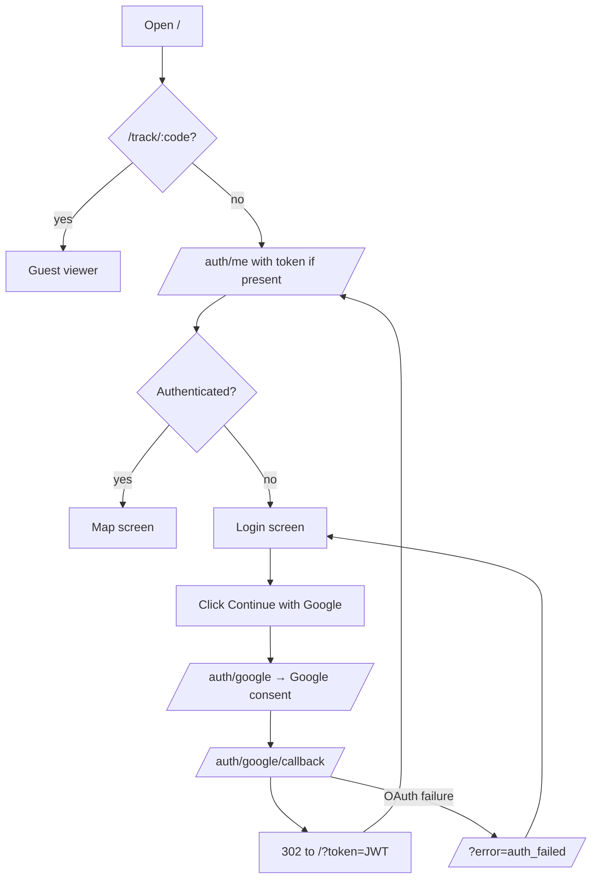
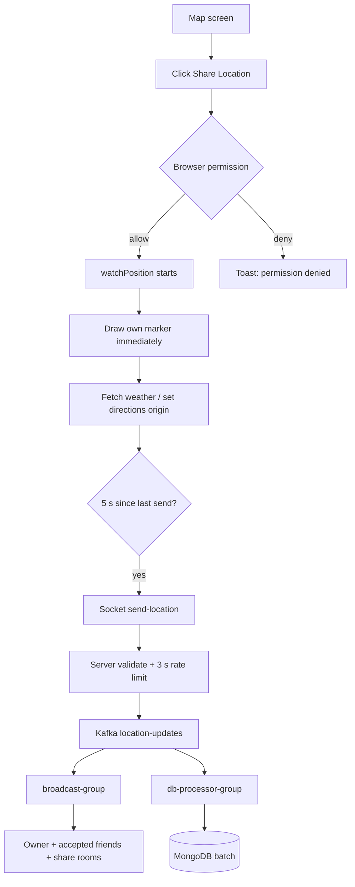
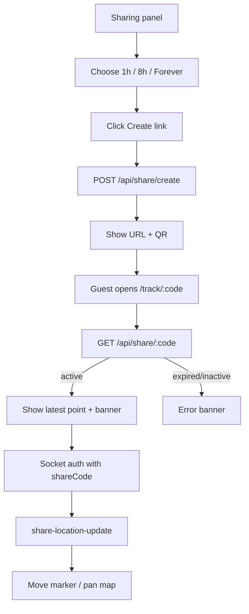
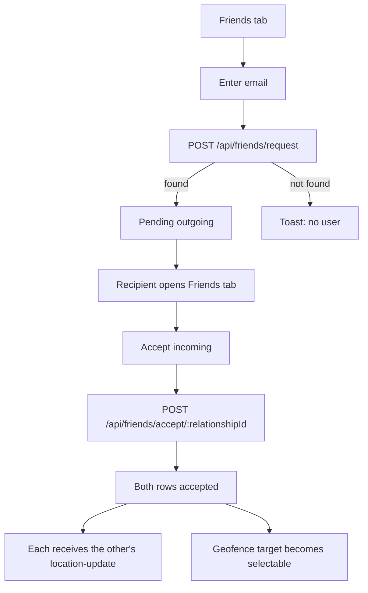
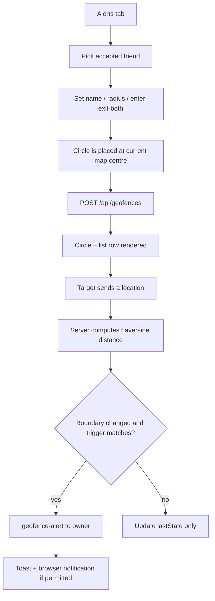

# Live Location Tracker — UX Flows

> The end-to-end journeys a real user takes.
> Filled from `frontend/js/app.js`, `auth.js`, `sharing.js`, `geofencing.js`,
> and the backend routes on 2026-10-20.

---

## 1. Flow Index

| # | Journey | Entry point |
|---|---|---|
| 2 | First visit and Google sign-in | `/` with no valid session/JWT |
| 3 | Start sharing and watch friends | Login screen → “Share Location” / geolocation prompt |
| 4 | Create and open a share link | Map → Sharing panel → “Create link” |
| 5 | Add and accept a friend | Map → Sharing panel → Friends tab |
| 6 | Create a geofence alert | Map → Sharing panel → Alerts tab |
| 7 | Stop sharing and log out | User panel → Stop / Logout |
| 8 | Search, route, and map tools | Search bar / Directions / Tools dock |

There is no sign-up form. Every account is created by the Google OAuth
callback on first sign-in.

---

## 2. First Visit and Google Sign-In

**Goal:** Authenticate and reach the live map.
**Preconditions:** A Google account and a configured OAuth client.



| Step | Screen | Action | System response |
|---|---|---|---|
| 1 | Browser | Opens `/` | `app.js` checks for a `/track/:code` route first; otherwise calls `AuthManager.checkAuth()` |
| 2 | Login | Sees the glass login card and feature list | No map is initialised yet |
| 3 | Login | Clicks “Continue with Google” | `window.location.href = /auth/google` (rewritten by Vercel to the backend) |
| 4 | Google | Chooses an account and consents | Google redirects to `/auth/google/callback` on the Vercel domain |
| 5 | Backend | Passport creates/updates the user and serialises the session | Signs a 24-hour JWT |
| 6 | Browser | Receives `302 /?token=...` | `checkAuth` stores the token in `localStorage`, removes it from the URL, and calls `/auth/me` |
| 7 | Map | `/auth/me` returns the user | Login screen hides; map, search, directions, tools, sharing, geofencing, and socket initialise |

**Failure modes**

| Failure | What the user sees | Expected |
|---|---|---|
| Google OAuth fails or is cancelled | Redirect to `/?error=auth_failed`, then the login screen | A message explaining the failure would be better; the app currently does not read the `error` query parameter. |
| `/auth/me` fails (network/backend down) | Silent fallback to the login screen; console error | A visible “could not reach the server” message. |
| JWT expired | `/auth/me` returns 401; the app shows the login screen | Sign in again. |
| Session cookie blocked | JWT path still works | No visible difference in production. |
| Invalid `GOOGLE_CALLBACK_URL` | Google shows `redirect_uri_mismatch` before reaching the app | Fix the Google Console URI and server variable. |

The callback redirects with the JWT in the query string. The frontend removes
it with `history.replaceState`, but it may still be present in browser history
or proxy logs. See [SECURITY.md](./SECURITY.md) §9.

---

## 3. Start Sharing and Watch Friends

**Goal:** Put the user's live position on their own map and on their friends'
maps.
**Preconditions:** Signed in; browser supports geolocation.



| Step | Screen | Action | System response |
|---|---|---|---|
| 1 | Map | Clicks the share button in the user panel | The location prompt is shown on first use; if already watching, it requests a fresh position |
| 2 | Browser prompt | Allows location | `watchPosition` starts with high accuracy, 10 s timeout, 3 s maximum age |
| 3 | Map | — | Own marker is drawn immediately from the browser position, before any server round-trip |
| 4 | User panel | — | Coordinates and live weather appear; the share button becomes “Sharing” |
| 5 | Socket | Every ≥5 s | `send-location` is emitted; the server silently drops events within 3 s of the previous accepted event |
| 6 | Other users | — | `location-update` moves the marker and adds the user to the online list |
| 7 | Status bar | — | “Connected”; on disconnect, “Reconnecting…”; after 10 failed attempts, “Connection failed” |

**Failure modes**

| Failure | What the user sees | Expected |
|---|---|---|
| Browser has no geolocation | Toast “Geolocation is not supported by your browser” | Map remains usable; no marker |
| Permission denied | Toast “Location permission denied…”; prompt reappears | User can change browser settings and retry |
| Position unavailable / timeout | Toast; no position update | A retry control already exists via the share button |
| Socket disconnected | Status “Reconnecting…” / “Connection failed”; local marker still moves | Local position is not sent until reconnection; the next GPS update after reconnect is sent (there is no replay on `connect`) |
| Kafka unavailable | The socket handler emits “Failed to process location” | HTTP and map still work; positions are not broadcast or saved |
| Another tab is open | Multiple sockets are tracked; only the first connection emits `user-connected` | No session clash; disconnect only fires when the last socket closes |

The user's own marker is intentionally optimistic. A server or Kafka failure
does not remove it, so the UI can show a position that other users cannot see.
The status/toast is the only indication of that divergence.

---

## 4. Create and Open a Share Link

**Goal:** Let a guest watch the user's live position without an account.
**Preconditions:** Signed in.



| Step | Screen | Action | System response |
|---|---|---|---|
| 1 | Map → Sharing | Opens the community panel | Share, Friends, and Alerts tabs are available |
| 2 | Share tab | Selects a duration (`1h`, `8h`, `forever`) | Default is `1h` |
| 3 | Share tab | Clicks “Create link” | `POST /api/share/create` returns a session with a 5-byte base64url code |
| 4 | Share tab | — | A link `${origin}/track/<code>` appears in a read-only input; the QR renders if `QRCode` is loaded |
| 5 | Share tab | Copies the link | Clipboard write + “Share link copied” toast |
| 6 | Guest browser | Opens `/track/<code>` | Vercel SPA fallback serves `index.html`; auth is bypassed |
| 7 | Tracking view | — | Banner shows the owner's name; the latest point is fetched and the map centres at zoom 16 |
| 8 | Tracking view | — | Socket connects with the share code and joins `share:<code>`; new points move the marker and pan the map |
| 9 | Owner | Clicks Stop in the session list | `POST /api/share/:code/stop`; the guest receives `share-session-ended` and the banner says “Sharing ended” |

**Failure modes**

| Failure | What the user sees | Expected |
|---|---|---|
| Create fails | Toast with the server message; no link | Stay on the form and allow retry |
| Guest link invalid/expired | Error banner with “This share link is inactive or expired” | No map marker or socket |
| Owner has no latest point | Banner and map load, but no marker until a new update | A “waiting for the owner” state would be clearer |
| Owner's last point aged out of the 24 h TTL | Same as no latest point, even though the link is active | The link is live but empty until the next update |
| Socket cannot connect | Guest sees the initial point but no live movement; `connect_error` calls the error callback | A visible connection status on the tracking banner |
| Owner stops the link | “Sharing ended” in the banner | The socket remains open but receives no further events; it is not explicitly disconnected by the UI |

`allowedViewers` is not exposed in the UI and is not enforced. A share link is
a bearer capability: anyone with the code can view it.

---

## 5. Add and Accept a Friend

**Goal:** Establish a mutual relationship so each user receives the other's
live position and can create geofences.
**Preconditions:** Both users have signed in at least once with Google.



| Step | Screen | Action | System response |
|---|---|---|---|
| 1 | Sharing → Friends | Enters an email | — |
| 2 | Friends | Clicks Add | `POST /api/friends/request`; the email is trimmed/lowercased and looked up |
| 3 | Friends | — | A pending row appears; the recipient sees an incoming row with an Accept button |
| 4 | Recipient → Friends | Clicks Accept | `POST /api/friends/accept/:relationshipId` sets the incoming row accepted and upserts the reciprocal accepted row |
| 5 | Both maps | — | Accepted friends receive each other's `location-update` events and appear online |
| 6 | Alerts tab | — | The friend is now available in the geofence target selector (`friends-updated` event) |

**Failure modes**

| Failure | What the user sees | Expected |
|---|---|---|
| Email invalid | Toast “Enter a valid email address” | No request created |
| No matching user | Toast “No user found with that email” | This also reveals whether an email is registered (see SECURITY). |
| Adding yourself | Toast “You cannot add yourself” | No request |
| Request already exists | `findOneAndUpdate` upserts/returns the existing row; the UI still says “Friend request sent” | Idempotent, but the message can be misleading |
| Accept fails | List does not change; no explicit error toast in the current handler | A visible error would be better |
| Remove | Deletes both directional rows and refreshes the list | The other user stops receiving updates and geofences can no longer target them |

---

## 6. Create a Geofence Alert

**Goal:** Notify the owner when an accepted friend enters or leaves an area.
**Preconditions:** Signed in; at least one accepted friend; browser
notifications optional.



| Step | Screen | Action | System response |
|---|---|---|---|
| 1 | Sharing → Alerts | Opens the tab | Fences are loaded and drawn as purple circles at their stored centres |
| 2 | Alerts | Chooses a friend, name, radius (default 250 m), trigger | The target list comes from `friends-updated` |
| 3 | Alerts | Clicks Create | The circle is centred on the **current map centre**, not the mouse; `POST /api/geofences` validates the friendship and fields |
| 4 | Map | — | A `L.circle` is drawn with a tooltip; the list shows name, radius, and target |
| 5 | Alerts | Clicks Enable notifications | `Notification.requestPermission()`; this is optional |
| 6 | Target's browser | Sends a location | The server evaluates every active fence watching that user |
| 7 | Owner | — | On the first accepted transition after `unknown`, a connected owner gets an in-app toast; a browser notification appears only if permission was granted |

**Failure modes**

| Failure | What the user sees | Expected |
|---|---|---|
| No friends | Toast “Add a friend before creating an alert” | Create is blocked |
| Target is not an accepted friend | `403` → toast “Alerts can only target accepted friends” | No fence |
| Radius outside 25–100000 m | Mongoose validation error reaches Express's default handler → 500 (HTML error page in production), not a route-level 400; the frontend's `response.json()` can reject before a toast | A 400 with a clear message would be better |
| Name too long | Same default-handler 500 path | A 400 with a clear message |
| Notifications denied | Toast “Notifications were not enabled” | In-app toasts still work |
| Target's first event after creation | No alert (state starts `unknown`) | Documented behaviour: the first event establishes the baseline |
| Target stops sharing | No new events; no boundary transition | The fence remains but cannot fire |
| Multiple sockets/replicas | `lastState` is last-write-wins; a duplicate/missed alert is possible | Single process today; see [DATABASE.md](./DATABASE.md) §7 |

The geofence is evaluated **before** the event is produced to Kafka. A Kafka
failure does not prevent an alert from being emitted, because the alert is sent
directly to the owner's socket room.

---

## 7. Stop Sharing and Log Out

**Goal:** End consent and leave the app.
**Preconditions:** Signed in.

```mermaid
flowchart TD
    A[Share session list] --> B[Click Stop]
    B --> C[POST /api/share/:code/stop]
    C --> D[isActive=false]
    D --> E[share-session-ended to room]
    E --> F[Guest banner: Sharing ended]

    G[User panel] --> H[Click Logout]
    H --> I[clear watch + disconnect socket]
    I --> J[Remove auth_token]
    J --> K[/auth/logout]
    K --> L[Destroy session + clear cookie]
    L --> M[Redirect to CLIENT_URL]
```

| Step | Screen | Action | System response |
|---|---|---|---|
| 1 | Share tab | Clicks Stop on a live link | The session is marked inactive; the owner's list refreshes; the share room receives `share-session-ended` |
| 2 | User panel | Clicks Logout | `watchPosition` is cleared, the socket disconnects, `auth_token` is removed, and the browser navigates to `/auth/logout` |
| 3 | Backend | — | `req.logout`, session destroy, `connect.sid` clear, redirect to `CLIENT_URL` |

**Failure modes**

| Failure | What the user sees | Expected |
|---|---|---|
| Stop fails | List does not change; no explicit error toast | The link may remain active; a visible error is needed |
| Guest socket does not receive `share-session-ended` | The banner stays on the last state | Next HTTP refresh returns 404 |
| Logout with no session | Redirect may still occur; the JWT is already removed locally | — |
| Stolen/retained JWT after logout | **The JWT remains valid for up to 24 hours** | This is a real gap; only removing the client copy and destroying the session are implemented |

---

## 8. Search, Route, and Map Tools

**Goal:** Find a place, route to it, and inspect the map.
**Preconditions:** Signed in (the guest tracking view initialises search but not
directions/tools).

| Interaction | Flow |
|---|---|
| Search | Type ≥350 ms debounce → Nominatim search → results; recent searches are stored under `llt_recent_searches` (max 8); selecting a result flies to it and opens a marker |
| Reverse geocode | Right-click/long-press the map → context menu → “What's here?” → Nominatim reverse → address |
| Nearby POIs | Petrol / Hospital / Food buttons → Nominatim search within the current map bounds → markers; clicking a POI requests directions |
| Directions | Open the panel → enter origin/destination (or “Your location”) → choose driving/walking/cycling → OSRM route → summary + steps; moving >15 m from the origin triggers auto-reroute |
| Measure | Tools dock → distance or area → click points on the map → readout; clear to reset |
| Drop pin | Tools dock → drop a pin at the map centre |
| Fullscreen | Tools dock → request/exit browser fullscreen |
| Basemap | Layer picker → Dark (Esri), Standard (OSM), Light (Esri), Satellite (Esri), Terrain (OpenTopoMap); choice persisted |

**Failure modes**

| Failure | What the user sees | Expected |
|---|---|---|
| Nominatim rate-limits/blocks | Empty result list or error text | No local fallback |
| OSRM unavailable | Route error toast/text | Map/search still work |
| Geocode fallback needed | The directions module strips building/house prefixes and common road suffixes, then retries | This is a heuristic, not a guaranteed fix |
| Tile provider unavailable | Blank/failed tiles | No explicit error state |
| Fullscreen denied | Console error; no UI change | Browser policy |

---

## 9. Empty and First-Run States

| Screen | Brand-new account sees |
|---|---|
| Login | Google button, app logo, three feature chips; no “create account” form |
| Map | The map at India centre, zoom 5, until the first own position arrives; the location prompt is visible until the user shares |
| Online users | “No users online” (the local user is added to the list after auth, so this appears only before the socket's `active-users` event) |
| Share links | “No share links yet.” |
| Friends | “Add a friend by email.” |
| Geofences | “No arrival alerts yet.” |
| Weather | Hidden until the first successful fetch |
| Guest tracking | Banner with the owner's name, but no marker if no latest point |

There is no onboarding tour, sample data, or “invite a friend” prompt beyond
the empty-state text.

---

## 10. Loading Behaviour

- **Auth:** no spinner; the login screen remains until `/auth/me` resolves.
- **Search:** 350 ms debounce, then a spinner row; results replace it.
- **POIs:** a loading row/text while the request is in flight.
- **Directions:** route search shows a loading message; the summary and steps
  replace it when resolved.
- **Lists:** no skeletons; the previous list stays until a refresh resolves.
- **Socket:** status text changes to “Reconnecting…” and then “Connection
  failed”; no blocking overlay.
- **Toasts:** optimistic success/error after the request resolves; no undo.
- **Service worker:** caches the shell, map tiles, and same-origin API GETs
  cache-first. A cached `/auth/me`, friend list, or share lookup can survive a
  deploy or logout; the cache is not cleared on logout. Hard-reload/unregister
  the worker to clear it. Socket events are not cached.

---

## 11. Responsive Behaviour

| Area | Desktop | ≤768 px |
|---|---|---|
| Search | Top-left, 360px | Full-width top bar |
| Online users | Left sidebar below search, 360px | Bottom sheet (50vh) opened from the People button |
| Directions | Left panel below search, 360px | Bottom sheet (70vh) |
| Community | Left panel below search, 360px | Bottom sheet (78vh) |
| User panel | Top-right card | Bottom card above the nav; coordinates hidden |
| Tools | Bottom-left dock | Hidden |
| Status bar | Top-centre | Hidden |
| Navigation | Panel buttons | Four-button bottom nav: Search, Directions, People, Locate |
| Guest tracking | Banner at top | Banner below the search area; all owner controls hidden |

---

## 12. Accessibility Notes

- Icon-only buttons are a mix of `title` and `aria-label`; there is no
  consistent accessible-name convention.
- There are no `:focus-visible` styles. A few controls have `:focus`/`:focus-within`
  styling (search bar, directions input); most controls rely on browser defaults.
- Side panels are not modal dialogs: no focus trap, no `aria-modal`, no focus
  restore when closed.
- Toasts and geofence alerts are not in an `aria-live` region, so screen
  readers may not announce them.
- The Leaflet map has no keyboard-accessible list of users or search results
  outside the search panel.
- `prefers-reduced-motion` is not respected for the animated orbs, logo, marker
  pulse, or panel transitions.
- No screen-reader or automated accessibility test has been run. See
  [DESIGN_SYSTEM.md](./DESIGN_SYSTEM.md) §8.
